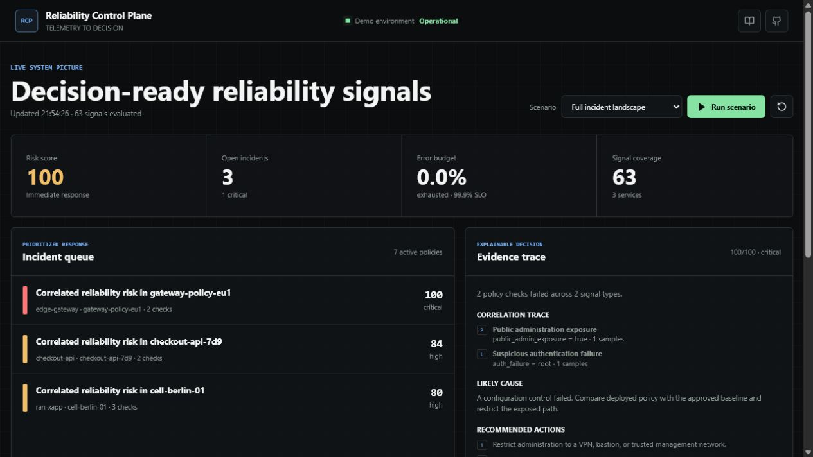
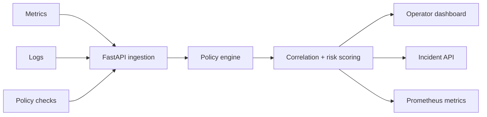

# Reliability Control Plane

[](https://github.com/amandesi13/reliability-control-plane/actions/workflows/ci.yml)
[](https://www.python.org/)
[](https://fastapi.tiangolo.com/)
[](https://amandesi13.github.io/reliability-control-plane/)
[](LICENSE)

**[Live demo](https://amandesi13.github.io/reliability-control-plane/)**: the operator dashboard with the real policy and correlation engine running in your browser on Pyodide (WebAssembly). Pick a scenario and run it; no server involved.

An explainable reliability-engineering platform that correlates **metrics**, **logs**, and
**security-policy drift** into prioritized incidents. It combines the strongest ideas from my
telecom observability, distributed log-monitoring, and firewall-validation projects in one
production-style control plane.



## Why this project exists

Monitoring tools are good at producing alerts. Operators still have to decide which alerts belong
together, what evidence supports them, and what to inspect first.

Reliability Control Plane closes that gap:

1. Ingest heterogeneous operational signals through one typed contract.
2. Evaluate transparent policy-as-code rules.
3. Correlate violations by service, entity, and evidence window.
4. Increase risk when independent signal types agree.
5. Return a root-cause hypothesis and ordered remediation steps.
6. Track a 99.9% SLO and expose the result to Prometheus.

## Product tour

The dashboard is an actual operator surface, not a landing page:

- prioritized incident queue with risk scores;
- click-through evidence and correlation trace;
- deterministic root-cause hints and recommended actions;
- recent metrics, logs, and policy signals;
- error-budget status;
- built-in healthy, dependency-failure, RAN-congestion, and security-drift scenarios.

## Architecture



The default policy pack includes sustained latency, timeout bursts, RAN PRB saturation, packet
loss, weak SINR, public administration exposure, and suspicious authentication failures.

See [docs/architecture.md](docs/architecture.md) for design decisions and extension points.

## Quick start

### Docker

```bash
docker compose up --build
```

Open:

- Dashboard: <http://localhost:8080>
- OpenAPI: <http://localhost:8080/docs>
- Prometheus metrics: <http://localhost:8080/metrics>

### Python

```bash
python -m venv .venv
python -m pip install -e ".[dev]"
rcp serve --reload
```

Run the correlation engine without starting a server:

```bash
rcp simulate full-demo
rcp simulate dependency-failure --json
```

## API example

```bash
curl -X POST http://localhost:8080/api/signals \
  -H "Content-Type: application/json" \
  -d '{
    "signals": [{
      "source": "firewall-ci",
      "service": "edge-gateway",
      "entity": "gateway-policy-eu1",
      "kind": "policy",
      "name": "public_admin_exposure",
      "value": true,
      "message": "SSH is reachable from 0.0.0.0/0"
    }]
  }'
```

## Browser demo

The [live demo](https://amandesi13.github.io/reliability-control-plane/) is the same `static/` dashboard served from GitHub Pages. GitHub Pages has
no server, so `web/pyodide-api.js` starts the control plane in Pyodide and answers the
dashboard's `fetch("/api/...")` calls from `web/bridge.py`. The dashboard code itself is unchanged.
`tests/test_web_bridge.py` replays the dashboard's calls against both the bridge and the FastAPI
app and requires identical JSON, apart from ids and timestamps. The `demo` workflow builds the
site with `python web/build_site.py` and deploys it on every push to `main`.

```bash
python web/build_site.py _site
python -m http.server -d _site 8000   # http://localhost:8000
```

## Engineering quality

The CI pipeline enforces:

- Ruff linting;
- strict mypy type checking;
- branch-aware pytest coverage of at least 85%;
- Docker image build;
- container health smoke test.

Run the same checks locally:

```bash
ruff check .
mypy
pytest
```

## Resume-ready summary

> Built a Python/FastAPI reliability control plane that correlates metrics, logs, and
> policy-as-code violations into explainable incidents; implemented SLO/error-budget tracking,
> telecom scenarios, Prometheus export, a responsive operator dashboard, Docker deployment, and
> coverage-gated CI.

## Relationship to my earlier projects

This repository consolidates and extends ideas proven in:

- [OAI RAN Metrics xApp Lab](https://github.com/amandesi13/oai-ran-metrics-xapp-lab)
- [Distributed Log Monitoring and Alerting System](https://github.com/amandesi13/distributed-log-monitoring-alerting-system)
- [AI-Assisted Firewall Validation Engine](https://github.com/amandesi13/AI-Assisted-Firewall-Validation-Engine)

The earlier repositories remain focused demonstrations. This project is the portfolio-level
system that unifies them behind one operational model.

## Safety

Recommendations are advisory. The project never changes infrastructure automatically. Review
[SECURITY.md](SECURITY.md) before connecting a real telemetry source.

## License

MIT
