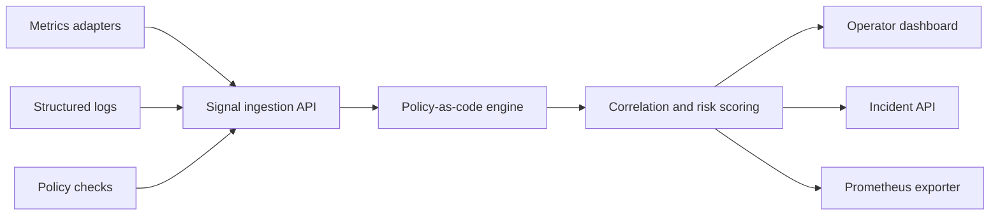

# Architecture

Reliability Control Plane separates evidence collection from deterministic policy evaluation
and incident correlation.

## Design choices

### One signal contract

Metrics, logs, and policy findings use the same typed `SignalEvent` model. This keeps adapters
replaceable and prevents the correlation engine from depending on source-specific formats.

### Deterministic first

Every violation points to:

- the exact rule that failed;
- the observed value and threshold;
- the evidence count and correlation window;
- an explicit recommendation.

The platform can later add an LLM explanation layer, but correctness does not depend on one.

### Cross-signal correlation

Violations are grouped by service and entity. Risk increases when independent signal types
agree. A latency threshold plus matching timeout logs therefore ranks above either signal alone.

### Advisory remediation

The platform proposes actions but does not mutate infrastructure. This makes it safe to use in
learning environments and provides an intentional approval boundary for future automation.

## Extension points

- Replace scenario data with OpenTelemetry, Prometheus, OAI, or E2/KPM adapters.
- Store events and incidents in PostgreSQL or ClickHouse.
- Publish incidents to Jira, Slack, PagerDuty, or an O-RAN rApp.
- Add signed policy packs and deployment-aware baselines.
